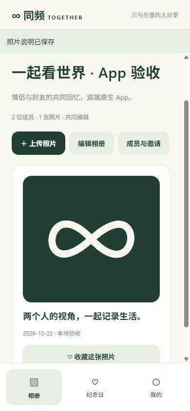

# 验收记录 · 2026-10-22

## 已执行

| 检查                            | 结果                     | 范围                                                                                       |
| ------------------------------- | ------------------------ | ------------------------------------------------------------------------------------------ |
| npm run verify                  | 通过                     | 后端 TypeScript 编译、13 项服务端测试、客户端类型检查、6 项客户端测试                      |
| TEST_DATABASE=postgres 后端测试 | 13/13 通过               | PostgreSQL/PGlite：包括原生 Bearer、QQ 验证、编辑者/只读者、图片鉴权、重置撤销会话         |
| Expo export --platform all      | Android/iOS/Web 导出通过 | Hermes JS 资源，非 APK/IPA                                                                 |
| Expo prebuild Android           | 通过                     | 生成 Android 原生工程，尚未 Gradle 编译安装                                                |
| Expo install --check            | 通过                     | SDK 58 对齐的依赖版本                                                                      |
| 本地 UI 辅助验收                | 通过                     | 两个隔离账号、创建相册、系统选图网页适配、压缩上传、邀请、B 接受、私有图片显示、B 修改描述 |
| 手机宽度辅助预览                | 通过                     | 390×844，表单/相册无横向溢出；不等同 Android/iOS 真机                                      |

界面验收发现默认 fetch 被作为类方法调用的问题，已改用包装函数保留调用上下文，并添加回归测试。file mailer 的邀请提示已明确为本地文件模式，不声称发出真实邮件。

后端测试覆盖：正确/错误密码、QQ 限制、验证过期/单次使用、重置保留相册与旧会话撤销、邀请错误收件人/过期/撤销、权限隔离、图片非法格式与配额、乐观锁、事务回滚、Netlify 二进制响应与 SQL 参数化。PostgreSQL 测试使用本地 PGlite，不代表真实 Supabase 项目已联通。

辅助界面证明（此为 React Native Web 渲染，非真机截图）：

## 依赖审计

后端 npm audit 为 0 漏洞。客户端 Expo 工具链 npm audit 报告 15 个高风险受影响依赖条目，归因于两个上游公告：

- braces <=3.0.3：嵌套模式导致栈耗尽，GHSA-vfj7-8cjw-p6xm。
- node-forge <=1.4.0：RSA 签名验证问题，GHSA-86w9-cpqp-85rv。

2026-10-22 官方 npm 查询最新版本仍分别为 3.0.3 / 1.4.0；没有可安全升级的修复版本。未使用 npm audit fix --force 降级 Expo，也未把审计标记为通过。当前这些依赖位于构建/开发工具链；在受信任源码环境构建，正式发布前复查上游补丁并重新验收。此处不宣称整体无安全风险。

## 未验收及发布门槛

- 当前 Windows 环境没有可用的 JDK/Android SDK/adb，未生成签名 APK、未连接 Android 真机；Windows 不能执行 Xcode/iOS 本地编译。
- 未连接用户 Expo/EAS 项目、Apple 签名或真机分发凭据，未生成 IPA，也未上架。
- 未在真机验收权限拒绝/取消、SecureStore 重启恢复、邮件 scheme、系统分享、后台恢复和弱网。请按 SOP 的双账号清单执行。
- 未部署新 API、未对真实生产 QQ SMTP 发信、未迁移现有用户和相册；线上联通不能以本地 file mailer 测试替代。
- 源码提交 99fc295 已在 GitHub 核验；Actions 首次运行全部通过，结果见下方远端记录。
- 系统纪念日通知、Universal Links / App Links、账号自助删除及商店隐私材料尚未实现，不在当前核心好友相册内测交付中。

复现环境：Node.js 22、Expo SDK 58、React Native 0.88、React 19.3。命令见 README 和 DEPLOYMENT。

## 远端交付

仓库：https://github.com/kismetcccc/together_app 。源码提交：99fc295d6f129e1f8ea92172d2dc4aef8942257f。

本地最后一次重复原生导出因自动审批服务两次超时未执行；不是编译失败。此前双平台导出已通过，最终文字提示修改后的类型检查与测试通过，GitHub CI 随后已成功完成最终版本 Android/iOS/Web 导出及上传产物，补齐最终源码的构建证据。

GitHub Actions：[运行 39730670032](https://github.com/kismetcccc/together_app/actions/runs/39730670032)，conclusion=success。全新 Ubuntu/Node 22 环境完成 npm ci、依赖安装、全部测试、双平台 JS 导出和产物上传。产物名称 native-js-export-not-installable，不能直接安装到手机。
